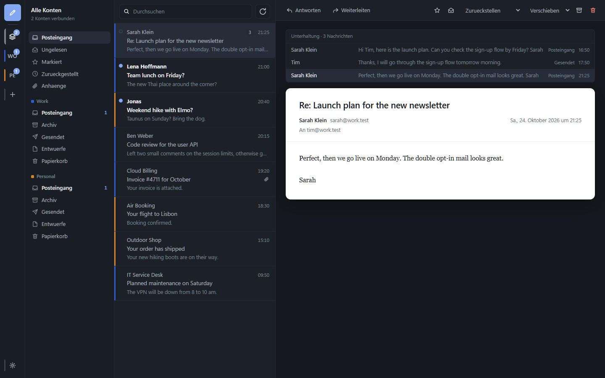

# Mailclient

An ad-free desktop mail client for several accounts at once: Gmail, iCloud, WEB.DE, GMX, Outlook,
Posteo, mailbox.org and anything else that speaks IMAP. Nothing phones home. There is no account with
the maker, no telemetry and no cloud service in between; the client only talks to your mail servers.

Built with Electron, React and TypeScript. The interface is in German.



## What it does

- **Several accounts at once**, kept apart. Every account has its own colour; in combined views it
  marks each row on the left, inside a single account's folder it disappears again.
- **Unified inbox** across all accounts, plus combined views for unread and flagged mail, or the full
  folder tree per account.
- **Instant delivery** in the inbox over IMAP IDLE, other folders on an adjustable interval.
- **Readable offline.** Headers and the most recently loaded message bodies are stored locally. What
  fails to send for lack of a network waits in an outbox and goes out by itself later.
- **External images are blocked** until you ask for them, so tracking pixels in newsletters don't fire
  every time you open one.
- **Writing** with reply, reply all, forward, attachments (drag and drop or paste), a signature per
  account and quoting in the usual format.
- **Conversations.** Mails that answer each other are one row in the list; the reader shows the whole
  thread including your own replies from Sent. Missing parts are fetched from the server. Can be
  switched off under *Settings → Appearance*.
- **Undo send.** After *Send*, the message waits a few seconds in the outbox; *Undo* takes it back into
  the editor. The delay is adjustable (default 10 seconds, 0 turns it off).
- **Send later.** The message stays in the outbox until the chosen time and can be edited or sent right
  away from there. The app has to be running for this; the system tray is enough.
- **Snooze.** Hides a mail until you need it; at that time it is back at the top, unread. This is local
  on purpose: on the server and on other devices the mail stays where it is.
- **Templates** for texts you write again and again, and **rules** for incoming mail.
- **Search** across the local store, plus server-side search for everything not downloaded yet, with
  shortcuts to narrow it down (see below).
- **Attachments** of all accounts in one view, with file names in the list.
- **No duplicates.** Gmail's "All Mail", "Important" and "Starred" views are neither shown nor synced,
  and a mail with several labels appears only once in combined views and search.
- Runs in the background with notifications and an unread count in the taskbar.
- Light and dark, keyboard shortcuts, airy or compact list.

Not included: PGP/S-MIME, calendar, contacts, server-side filter rules.

## Setting up accounts

Type your address, the rest is detected. For most providers the password is **an app password, not
your account password.**

| Provider | What you need |
|---|---|
| **Gmail** | Turn on 2-step verification, then create an app password at [myaccount.google.com/apppasswords](https://myaccount.google.com/apppasswords). Normal passwords are rejected since March 2025. |
| **iCloud** | Create an app-specific password at [account.apple.com](https://account.apple.com) under *Sign-In and Security*. If sign-in fails, try only the part before the `@` as user name. |
| **WEB.DE / GMX** | Enable IMAP first in the web interface under *Settings → POP3/IMAP*. Then use the mailbox password or an application password created there. |
| **Outlook.com** | 2-step verification plus an app password. For business accounts the administrator may have blocked IMAP. |
| **Posteo, mailbox.org** | Your normal account password. |

*Test connection* in the wizard checks IMAP and SMTP separately and tells you which one fails.

Passwords are encrypted with Electron's `safeStorage`, on Windows through the signed-in user's DPAPI.
Where the operating system offers no encryption (Linux without libsecret), the wizard says so clearly
instead of storing the password in plain text without a word.

## Keyboard

| Key | |
|---|---|
| `J` / `K`, arrow keys | next / previous message |
| `R` / `A` / `F` | reply / reply all / forward |
| `E` | archive |
| `Del` | move to trash |
| `S` | flag |
| `U` | mark as unread |
| `Ctrl+N` | new message |
| `Ctrl+Enter` | send |
| `Ctrl+F` | search |
| `Ctrl+R` | fetch now |
| `B` | snooze |

## Search shortcuts

Combine freely with normal search words; put values with spaces in quotes. German and English forms
both work.

| Shortcut | finds |
|---|---|
| `from:anna` | sender (name or address) |
| `to:team` | recipient, including Cc |
| `subject:"call back"` | word or phrase in the subject |
| `file:invoice` | name of an attachment |
| `has:attachment` | only mails with attachments |
| `is:unread`, `is:read`, `is:flagged` | by state |
| `before:2026-01-31`, `after:31.12.2025` | by date; also `today` and `yesterday` |

## Install

Unzip `Mailclient-0.1.0-windows-x64.zip` and start `Mailclient.exe`. The app is not signed, so
SmartScreen speaks up on first start: *More info → Run anyway*.

Building under WSL and using it on Windows:

```bash
npm run dist:win && scripts/install-windows.sh
```

This copies the app to `%LOCALAPPDATA%\Programs\Mailclient` and creates shortcuts on the desktop and in
the start menu. Your mail and accounts live separately under `%APPDATA%\Mailclient` and survive every
reinstall.

### As your default mail app

`scriptsuild-launcher.ps1` builds the starter exe and registers the client with Windows as an e-mail
app (per user, no admin rights). Windows does not let apps make themselves the default, so pick it once
under *Settings → Apps → Default apps → Mailclient → MAILTO*. From then on, "write to me" links on
websites open a new message with recipient, subject and text filled in.

## Develop

```bash
npm install
npm run dev          # development mode with hot reload
npm run typecheck
npm run build        # compiles to out/
npm run dist:win     # Windows ZIP in dist/
npm run dist:linux   # AppImage
```

### Tests

`tests/e2e.mjs` drives the real app against a local mail server (GreenMail in Docker): conversations,
sending with a delay and at a set time, snooze, templates, search and the basics. The app runs with its
own empty data folder and a hidden window, so real accounts stay untouched.

```bash
docker run -d --name mailclient-greenmail -p 3465:3465 -p 3993:3993 -p 8080:8080 \
  -e GREENMAIL_OPTS="-Dgreenmail.setup.test.all -Dgreenmail.hostname=0.0.0.0 -Dgreenmail.auth.disabled" \
  greenmail/standalone:2.1.3
npm run build && npm run test:e2e
```

`tests/showcase.mjs` fills two demo mailboxes and takes the screenshot above.

`npm run dist:win:installer` also builds an NSIS installer and a portable exe. That only works on
Windows itself, because electron-builder would need Wine for it.

## How it is built

```
src/
  main/        Electron main process
    imap.ts    one open IMAP connection per account, sync and actions
    smtp.ts    build and send messages, translate errors
    store.ts   storage on disk, headers in memory
    service.ts glue and IPC endpoint
  preload/     the only bridge to the renderer (contextBridge)
  renderer/    the React interface
  shared/      types, provider presets, search, conversations
tests/
  e2e.mjs      end-to-end test against GreenMail
```

Two decisions that explain the rest:

**No database.** Instead of SQLite, headers are stored as JSON per folder on disk and fully in memory
(about 0.5 kB per message), message bodies as single files next to them. So the app has not a single
native module, and only that makes it possible to build the Windows version on Linux.

**Messages render in an iframe without `allow-scripts`.** The HTML is cleaned with DOMPurify first, but
the sandbox is the real boundary: nothing in a mail can run, even if the cleaning misses something.
`allow-same-origin` stays set so the height can be measured; without `allow-scripts` there is nothing
that could use that access.

## License

MIT
